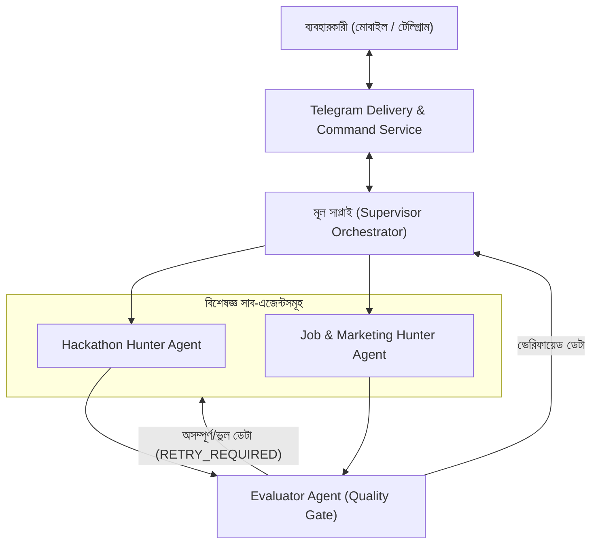

# Implementation Plan - Hierarchical Multi-Agent Radar & Automation System

**Feature Identifier**: `001-multi-agent-system`  
**Status**: IN PROGRESS (Phase 1)  

---

## 1. Technical Architecture Overview



---

## 2. File Organization & Boundaries

```text
MY MULTIFULL AGENT/
├── .env                          # API কী, টেলিগ্রাম টোকেন ও কনফিগ
├── requirements.txt              # লাইব্রেরি ডিপেনডেন্সি
├── main.py                       # এন্ট্রি পয়েন্ট ও সেন্ট্রাল রানার
├── models/
│   └── schema.py                 # স্ট্রাকচার্ড ডেটা স্কিমা (Pydantic)
├── agents/
│   ├── supervisor.py             # মূল সাপ্লাই (Orchestrator)
│   ├── hackathon_agent.py        # হ্যাকাথন বিশেষজ্ঞ সাব-এজেন্ট
│   ├── job_marketing_agent.py    # রিমোট জব ও মেটা/গুগল অ্যাডস সাব-এজেন্ট
│   └── evaluator_agent.py        # ইভালুয়েটর (ফিডব্যাক ও সেলফ-কারেকশন লুপ)
├── bot/
│   └── telegram_service.py       # টেলিগ্রাম ইন্টারেক্টিভ ডেলিভারি ও স্ল্যাশ কমান্ড হ্যান্ডলার
└── tests/
    └── test_evaluator.py         # স্বয়ংক্রিয় ভ্যালিডেশন টেস্ট
```

---

## 3. Concrete Implementation Steps

1. **Schema Refactoring (`models/schema.py`)**:
   - `EvaluationVerdict`: `APPROVED`, `RETRY_REQUIRED`, `PERMANENT_REJECT`.
   - `RetryFeedback`: মিসিং ফিল্ড এবং সাব-এজেন্টের জন্য রি-ট্রাই নির্দেশিকা।
   - `ProposalTemplate`: ৩ ধরনের কভার লেটার ও কোল্ড পিচ।

2. **Decouple Agents**:
   - `hackathon_agent.py`: কেবল হ্যাকাথন স্ক্র্যাপিং ও রি-ট্রাই হ্যান্ডলিং।
   - `job_marketing_agent.py`: মেটা মার্কেটিং, গুগল অ্যাডস ও এআই/ওয়েব জব স্ক্র্যাপিং ও রি-ট্রাই হ্যান্ডলিং।

3. **Evaluator Reflection Loop (`evaluator_agent.py`)**:
   - ডেটা অসম্পূর্ণ থাকলে সাব-এজেন্টকে ডেকে মিসিং ফিল্ড পূর্ণ করাবে (সর্বোচ্চ ৩ বার)।

4. **Telegram Commands Integration (`telegram_service.py`)**:
   - `/hunt_hackathon`, `/hunt_jobs`, `/test_agents`, `/run_now` কাস্টম হ্যান্ডলার যুক্ত করা।
